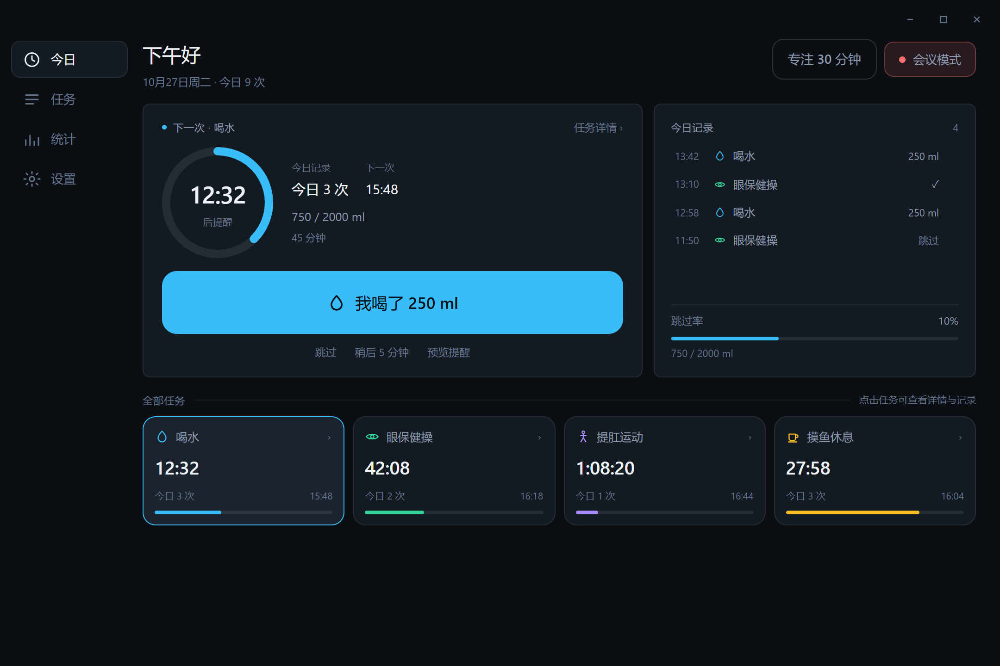
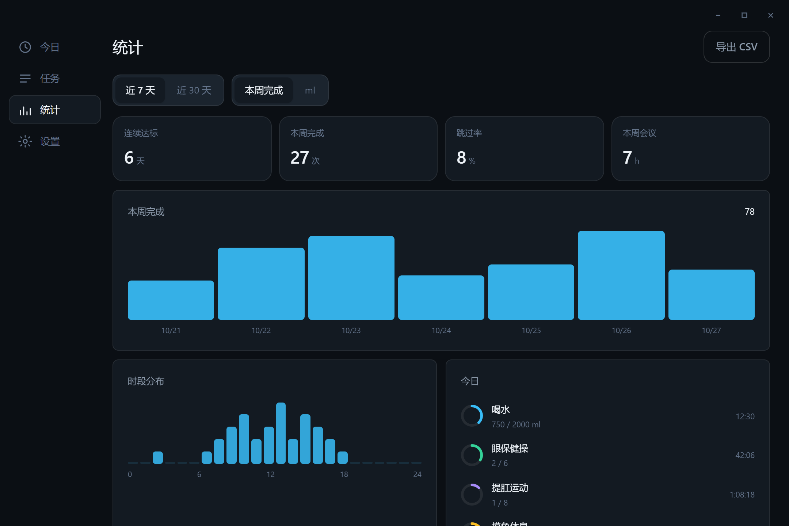
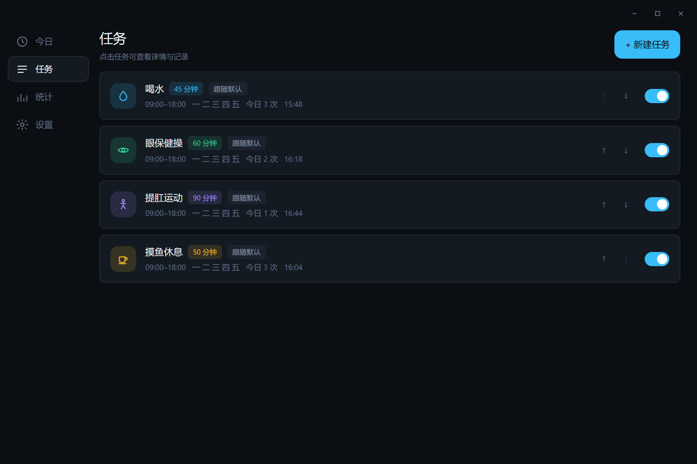
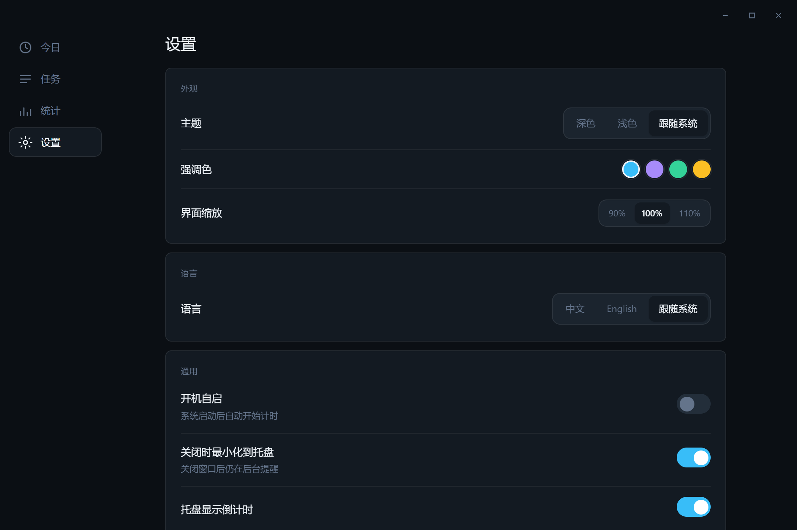
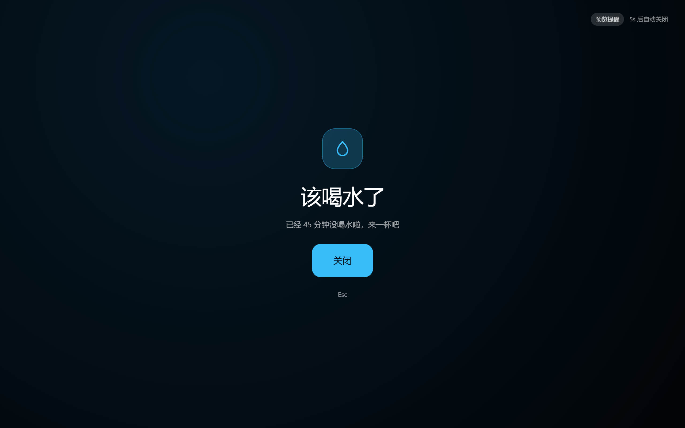
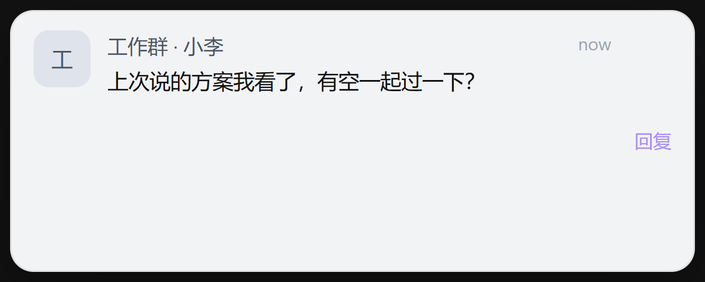

# 小满 · Sip

<p>
  
  
  
  
</p>

**久坐自救提醒**：把「喝水、眼保健操、提肛、起来摸鱼」拆成每次只要几十秒的小动作，到点提醒你一下，不打断手上的事。

> 小满是节气——麦粒渐满，未熟。不必一次装满，每次一小口刚好。
> 英文名 `Sip` 就是小口喝水。

## 界面

<table>
  <tr>
    <td width="50%"><br><sub><b>首页</b>：大号倒计时 + 完成按钮，右侧是今日流水，底部四个任务的独立计时</sub></td>
    <td width="50%"><br><sub><b>统计</b>：7 / 30 天柱状图、时段分布、连续达标与跳过率</sub></td>
  </tr>
  <tr>
    <td width="50%"><br><sub><b>任务</b>：整行可点进详情，「跟随默认 / 单独设置」提醒方式</sub></td>
    <td width="50%"><br><sub><b>设置</b>：主题 × 强调色 × 缩放、中英双语、安静时段</sub></td>
  </tr>
  <tr>
    <td width="50%"><br><sub><b>全屏提醒</b>：可换背景图 / GIF，8 套渐变预设，按 Esc 关闭</sub></td>
    <td width="50%"><br><sub><b>消息窗</b>：伪装成微信 / 邮件 / 系统通知，同事路过看不出端倪</sub></td>
  </tr>
</table>

## 功能

- **多任务独立计时**：喝水（按 ml 计量目标）、眼保健操、提肛、休息，外加自定义任务；每类独立统计，互不干扰。
- **三种提醒形态**：全屏（支持自定义图片 / GIF）、消息窗（4 套皮肤，可改发送人与正文）、系统原生通知。按任务类型分别配置。
- **安静时段**：全局最多 3 条作息（默认午休 12:00–13:30），命中时冻结计时、不提醒、不计漏做；离开时段后留 60 秒缓冲，避免刚回工位就被轰炸。
- **会议模式**：一键（或 `Ctrl/Cmd+Shift+M`）屏蔽所有提醒，常驻直到手动关闭，托盘显示 `●` 角标。
- **今日记录**：流水时间轴，可删除单条纠错；首页同时给出「今日 N 次」和「下次 HH:MM」。
- **提醒预览**：在设置或首页随时预览提醒长什么样，**不写记录、不动计时**。
- **主题与语言**：深色 / 浅色 / 跟随系统 × 4 种强调色 × 3 档缩放；中文 / English / 跟随系统。

## 几个刻意为之的设计

| 取舍 | 做法 | 为什么 |
| --- | --- | --- |
| 提醒被跳过时 | **冻结不重置**（`next_due += 1s`），不是「重新数 45 分钟」 | 否则连续几次跳过就永远等不到下一次提醒 |
| 同时到点 | 优先级队列 喝水 > 眼保健操 > 提肛 > 休息，间隔 3 秒串行弹出 | 四个任务一起弹会糊满屏幕 |
| 会议中 | 一律屏蔽，**不给「喝水放行」开关** | 会议里弹什么都尴尬，多一个开关只是多一次决策 |
| 提醒配置 | 设置里按类型定默认值，任务可选「跟随默认 / 单独覆盖」 | 两处都能配，必须明确谁说了算 |
| 提醒入口 | 「立即提醒」改为「预览提醒」 | 它的语义是「看看长什么样」，不是「提前完成」；提前完成请点主按钮 |

## 技术栈

| 层 | 选型 |
| --- | --- |
| 桌面壳 | Tauri 2（Rust）+ WebView2 / WKWebView |
| 前端 | React 19 · TypeScript strict · Tailwind v4 · Vite 7（多入口：主窗 / 提醒 / 消息窗各自独立 HTML） |
| 存储 | SQLite（`rusqlite` bundled，WAL），无服务端、无网络请求 |
| 调度 | Rust 后台线程，1 秒 tick；`parking_lot::Mutex<Engine>` |
| 平台能力 | 托盘、全局快捷键、开机自启、系统通知、多显示器全屏窗、锁屏 / 前台进程检测（`windows-sys`） |

```
src/                    前端
  app/pages/            今日 / 任务 / 任务详情 / 统计 / 设置 / 提醒个性化
  views/                全屏提醒页、消息窗页（独立 HTML 入口）
  components/           任务卡、表单、图表、SVG 图标
  lib/                  store、api、mock（浏览器调试用）、类型、设计 token
  i18n/                 zh / en 词典，缺键编译期报错
src-tauri/src/
  models.rs             Task / Settings / RemindProfile / Snapshot
  db.rs                 建表、迁移、统计、记录
  scheduler.rs          调度引擎（冻结 / 队列 / 优先级 / 安静时段 / 会议）
  windows.rs            全屏窗、消息窗、预览窗
  platform.rs           Windows 前台进程 / 锁屏检测
docs/                   PRD、技术设计、需求评审、截图
```

## 开发

```bash
npm install

npm run tauri dev   # 桌面端热重载
npm run dev         # 只跑前端：http://localhost:1420（用 mock 数据，方便调 UI）
```

前端有一套 mock 层，浏览器里也能跑完整界面（`src/lib/mock.ts`），不依赖 Rust 端。

## 构建

```bash
npm run tauri build
```

| 平台 | 产物 |
| --- | --- |
| Windows | `src-tauri/target/release/bundle/nsis/Sip_<version>_x64-setup.exe`、`.../msi/*.msi` |
| macOS | `src-tauri/target/release/bundle/dmg/*.dmg`（需在 macOS 上执行，无法交叉编译） |
| 免安装 | `src-tauri/target/release/sip.exe` |

## 数据与隐私

全部本地，不上传任何东西。

| 平台 | 路径 |
| --- | --- |
| Windows | `%APPDATA%\com.sip.desktop\sip.db` |
| macOS | `~/Library/Application Support/com.sip.desktop/sip.db` |

自定义背景图复制到同目录的 `media/`；设置页有「打开数据目录」按钮。

> **从旧版 Ticker（≤ v1.3）升级**：标识符变了，首次启动会自动把
> `com.ticker.desktop/ticker.db` 与 `media/` 复制到新目录（只复制不删除），
> 看到日志 `[sip] 已从旧版本目录迁移数据` 即成功，确认后可手动删掉旧目录。

## 快捷键

| 快捷键 | 作用 |
| --- | --- |
| `Ctrl/Cmd + Shift + M` | 开关会议模式 |
| `Ctrl/Cmd + Shift + H` | 唤起主窗口 |
| `Esc` / `Enter` | 全屏提醒中关闭 / 确认完成 |

## 已知限制

- macOS 版需在 macOS 上自行构建；Linux 未适配。
- 会议模式是手动开关，没有做「检测到腾讯会议 / 摄像头占用就自动进入」。
- 开机自启从旧版升级后，注册表 `Run` 里可能残留旧的 `ticker` 项，去设置里把自启关一次再开一次即可覆盖。

## 文档

- [产品需求文档（PRD）](docs/PRD.md)
- [技术设计文档](docs/DESIGN.md)
- [需求评审记录 v1.3](docs/需求评审-v1.3.md)

## 致谢与许可

基于 [rock-zhang/Shui](https://github.com/rock-zhang/Shui)（Apache-2.0）二次开发：托盘、多屏全屏窗与锁屏检测的实现思路来自该项目，前端与调度引擎为本项目重写。详见 [NOTICE](NOTICE)。

本项目采用 [Apache License 2.0](LICENSE)。

---

<details>
<summary>English</summary>

**Sip** is a tiny desktop companion for people who sit too long. It reminds you — every 45 minutes, or whatever you set — to drink water, rest your eyes, do a Kegel set, or just slack off for a minute.

- Multiple independent timers, each with its own stats
- Three reminder styles: fullscreen (custom image / GIF), disguised message popup (WeChat / mail / system skins), native notification
- Quiet hours (lunch break by default) that freeze timers instead of resetting them, with a 60-second grace period after you're back
- Meeting mode: one switch mutes everything
- Fully local: SQLite, no network, no telemetry
- Chinese / English UI, dark / light themes

Built with Tauri 2 + React 19 + Vite 7.

```bash
npm install && npm run tauri dev    # develop
npm run tauri build                 # package
```

</details>
